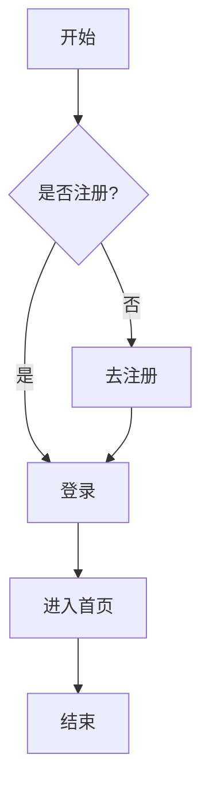
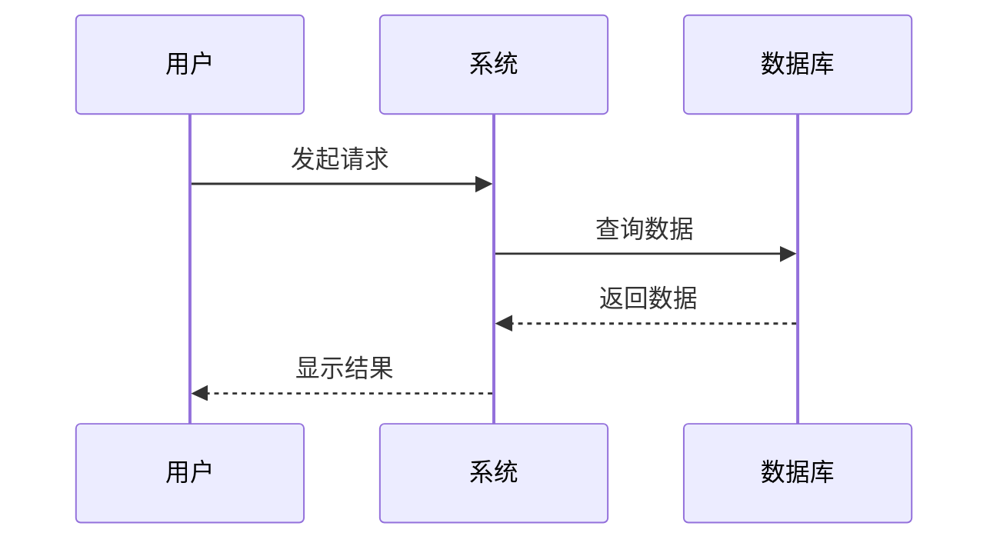
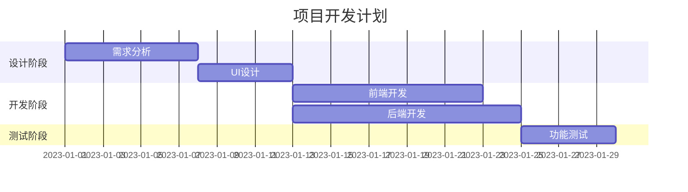

>引用: https://www.markdownassistant.com/zh/syntax

全面的 Markdown 语法示例与实时渲染对照，覆盖标题、粗体斜体、列表、引用、链接、图片、表格、代码块、脚注等常用语法，帮助您快速掌握 Markdown 写作。

---

## 基础格式

### 标题 (Headings)

**Markdown 源码：**

```markdown
# 这是一级标题
## 这是二级标题
### 这是三级标题
#### 这是四级标题
##### 这是五级标题
###### 这是六级标题
```
---

### 文本样式 (Text Style)

**Markdown 源码：**

```markdown
**这是加粗文本**
*这是斜体文本*
~~这是删除线文本~~
**_这是加粗斜体文本_**
==这是高亮文本==
^这是上标^
~这是下标~
```
---

### 引用 (Blockquotes)

**Markdown 源码：**

```markdown
> 这是一个引用块。
>
> > 这是一个嵌套的引用块。
> > 它可以有多层。
>
> 回到第一层。
```

**渲染效果：**

> 这是一个引用块。
>
> > 这是一个嵌套的引用块。
> > 它可以有多层。
>
> 回到第一层。

---

### 列表 (Lists)

**Markdown 源码：**

```markdown
**无序列表**：
- 项目 1
- 项目 2
  - 子项目 A
  - 子项目 B

**有序列表**：
1. 第一步
2. 第二步
3. 第三步

**任务列表**：
- [x] 已完成的任务
- [ ] 待办任务 A
- [ ] 待办任务 B
```

**渲染效果：**

**无序列表**：

- 项目 1
- 项目 2
  - 子项目 A
  - 子项目 B

**有序列表**：

1. 第一步
2. 第二步
3. 第三步

**任务列表**：

- [x] 已完成的任务
- [ ] 待办任务 A
- [ ] 待办任务 B

---

## 代码与表格

### 代码 (Code)

**Markdown 源码：**

````markdown
这是 `行内代码` 示例。

下面是代码块：

```javascript
function greet(name) {
  console.log(`Hello, ${name}!`);
}

greet('World');
```

```python
def factorial(n):
    if n == 0:
        return 1
    return n * factorial(n-1)
```
````

**渲染效果：**

这是 `行内代码` 示例。

下面是代码块：

```javascript
function greet(name) {
  console.log(`Hello, ${name}!`);
}

greet('World');
```

```python
def factorial(n):
    if n == 0:
        return 1
    return n * factorial(n-1)
```

---

### 表格 (Tables)

**Markdown 源码：**

```markdown
| 姓名 | 年龄 | 职业 |
| :--- | :--: | ---: |
| 张三 | 25 | 工程师 |
| 李四 | 30 | 设计师 |
| 王五 | 28 | 产品经理 |

*注：冒号用于控制列的对齐方式（左对齐、居中、右对齐）。*
```

**渲染效果：**

| 姓名 | 年龄 | 职业 |
| :--- | :--: | ---: |
| 张三 | 25 | 工程师 |
| 李四 | 30 | 设计师 |
| 王五 | 28 | 产品经理 |

*注：冒号用于控制列的对齐方式（左对齐、居中、右对齐）。*

---

## 链接与媒体

### 链接与图片

**Markdown 源码：**

```markdown
[访问谷歌](https://www.google.com)

这是一个带有鼠标悬停提示的链接：
[Markdown 官网](https://daringfireball.net/projects/markdown/ "Markdown Official")

图片示例：

```

**渲染效果：**

[访问谷歌](https://www.google.com)

这是一个带有鼠标悬停提示的链接：
[Markdown 官网](https://daringfireball.net/projects/markdown/ "Markdown Official")

图片示例：


---

## 数学公式 (LaTeX)

### 行内与块级公式

**Markdown 源码：**

```markdown
行内公式：质能方程 $E = mc^2$ 是物理学中最著名的公式之一。

块级公式（二次方程求根公式）：

$$
x = \frac{-b \pm \sqrt{b^2 - 4ac}}{2a}
$$

复杂公式示例：

$$
f(x) = \int_{-\infty}^\infty \hat f(\xi)\,e^{2\pi i \xi x} \,d\xi
$$
```

**渲染效果：**

行内公式：质能方程 $E = mc^2$ 是物理学中最著名的公式之一。

块级公式（二次方程求根公式）：

$$x = \frac{-b \pm \sqrt{b^2 - 4ac}}{2a}$$

复杂公式示例：

$$f(x) = \int_{-\infty}^\infty \hat f(\xi)\,e^{2\pi i \xi x} \,d\xi$$

---

## 图表 (Mermaid)

### 流程图 (Flowchart)

**Markdown 源码：**

````markdown

````

**渲染效果：**


---

### 时序图 (Sequence Diagram)

**Markdown 源码：**

````markdown

````

**渲染效果：**


---

### 甘特图 (Gantt Chart)

**Markdown 源码：**

````markdown

````

**渲染效果：**


---

