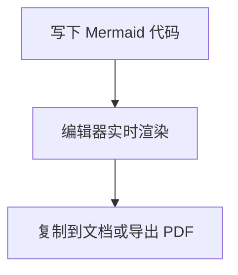
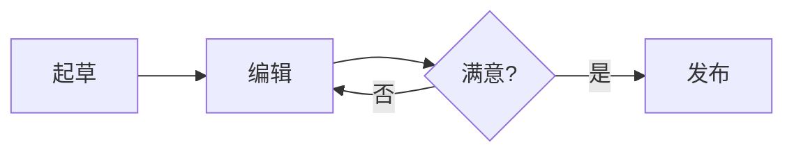
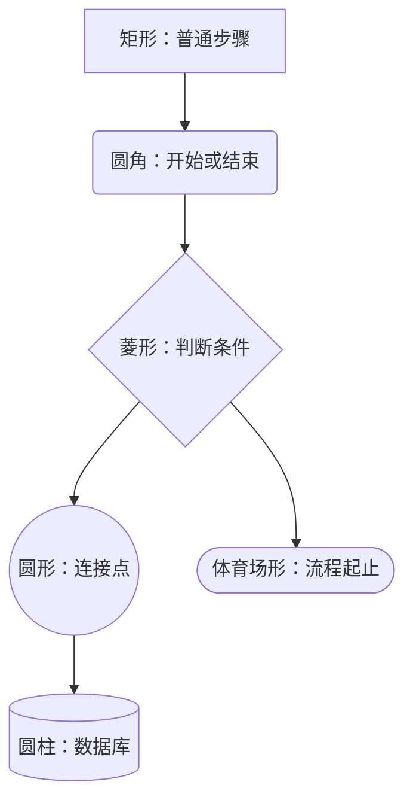
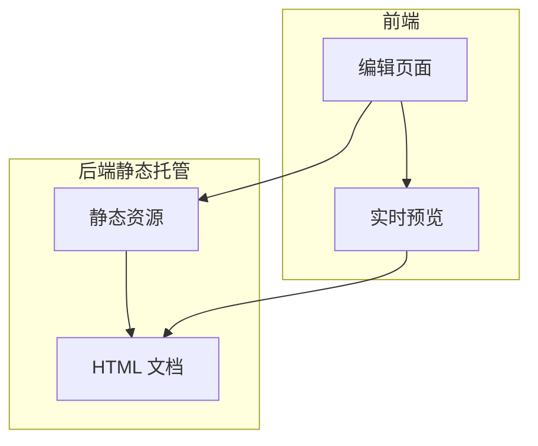
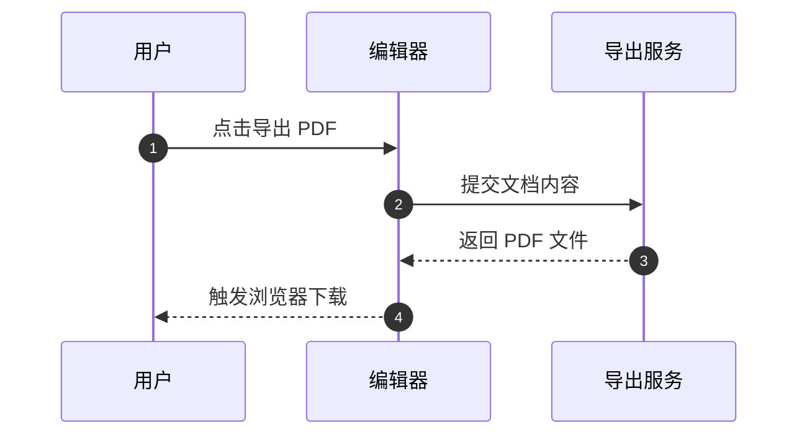
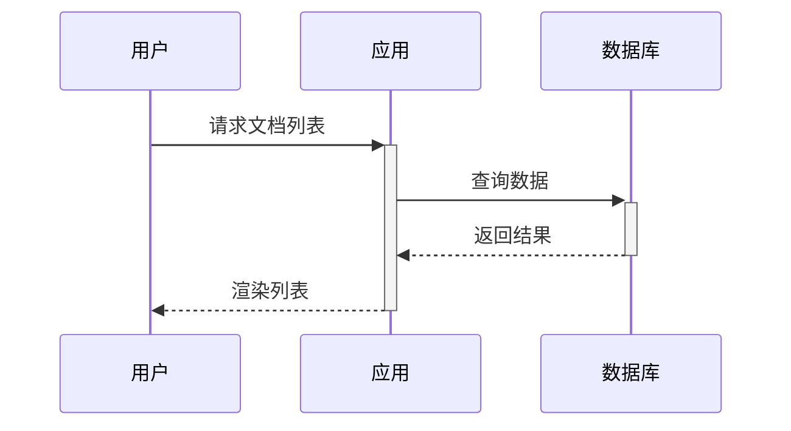
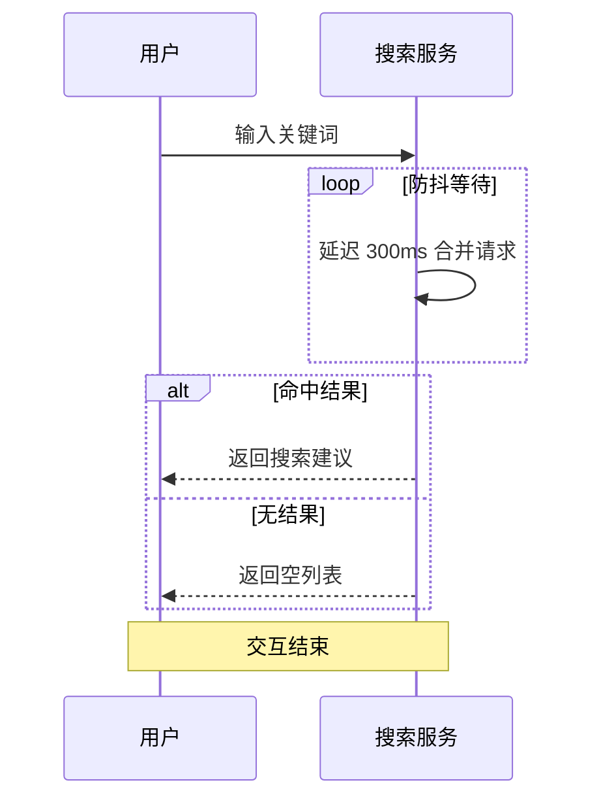
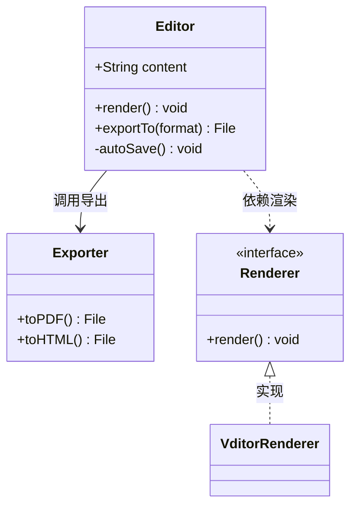
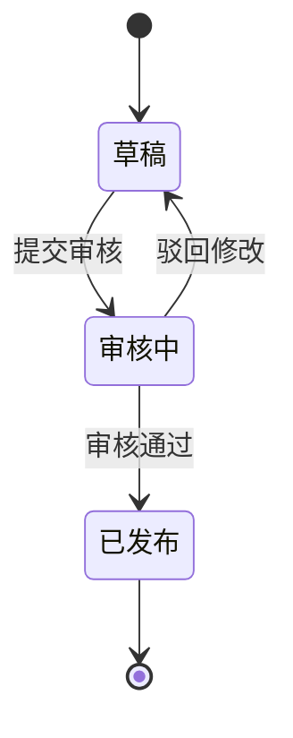

> 引用:https://www.markdownassistant.com/zh/mermaid

Mermaid 语法指南：流程图、时序图、类图、状态图、ER 图、甘特图与饼图的完整语法示例，每例均有实时渲染预览，可直接复制到 Markdown 编辑器中使用。

## 快速上手

### 在 Markdown 中使用 Mermaid

Mermaid 是一种用文本描述生成图表的语法，Markdown 编辑器会把 `mermaid` 代码块渲染成流程图、时序图、甘特图等图表。你只需要写几行文本，无需任何绘图软件。

**源码：**

````markdown

````

**渲染效果：**


编写时注意三点：代码块语言标记必须写成 `mermaid`；每行指令从行首开始（不要混用 Tab 与空格缩进）；图表声明（如 `graph TD`）必须是第一行。

### 第一个流程图：方向与连线

`graph TD` 声明一个自上而下（Top-Down）的流程图，`graph LR` 则是从左到右（Left-Right）。节点用任意标识符命名，`-->` 表示箭头连线：

**源码：**

````markdown

````

**渲染效果：**


把 `TD` 换成 `LR`、`BT`、`RL` 可以得到四个方向的布局。相同标识符的节点只会出现一次，重复写连线即可表达分支与循环。

## 流程图（Flowchart）

### 节点形状

不同的括号代表不同的节点形状，用于区分普通步骤、判断、起止等：

**源码：**

````markdown

````

**渲染效果：**



如果节点文字里包含括号、引号等特殊字符，用引号包裹文字即可：`A["含(括号)的文字"]`。

### 连线样式与标签

连线支持实线、虚线、粗线三种样式，还可以在连线上标注文字：

**源码：**

````markdown

````

**渲染效果：**


用箭头长度还能控制间距：`--->` 比 `-->` 更长。标签写法 `-- 文字 -->` 与 `-->|文字|` 效果相同，选一种保持全文统一即可。

### 子图（Subgraph）分组

`subgraph ... end` 把相关节点圈成一个分组，常用于划分模块或角色，配合连线表达模块间调用：

**源码：**

````markdown

````

**渲染效果：**


子图内还可以用 `direction LR` 单独指定这一组的布局方向，例如 `subgraph 前端` 下一行写 `direction LR`。

## 时序图（Sequence Diagram）

### 参与者与消息

`sequenceDiagram` 声明时序图，`participant` 定义参与者，`->>` 实线箭头表示请求，`-->>` 虚线箭头表示响应。加上 `autonumber` 可以为每条消息自动编号：

**源码：**

````markdown

````

**渲染效果：**


参与者按声明顺序从左到右排列；`as` 后面是显示名称，不写则直接显示标识符。

### 激活与生命周期

`activate`/`deactivate` 标记参与者的活跃时段（生命线上的矩形），也可以直接在消息末尾用 `+`（激活）和 `-`（结束）简写：

**源码：**

````markdown

````

**渲染效果：**


`+` 出现在目标参与者一侧，`-` 用于配对结束。配对使用能清楚表达调用栈的进入与退出。

### 注释与结构块

`note` 添加注释，`loop`、`alt/else`、`opt`、`par` 等结构块表达循环、分支与并行：

**源码：**

````markdown

````

**渲染效果：**


`note left of`、`note right of` 控制注释位置，`note over A,B` 让注释横跨多个参与者。

## 类图与状态图

### 类图（Class Diagram）

`classDiagram` 描述类、成员与关系。`+`、`-`、`#` 分别表示公有、私有、受保护；`-->` 实线关联、`..>` 虚线依赖、`<\|--` 继承、`<\|..>` 实现：

**源码：**

````markdown

````

**渲染效果：**


关系上的 `:` 后可以写中文说明；`<<interface>>` 这类构造型注解放在成员列表第一行。

### 状态图（State Diagram）

`stateDiagram-v2` 描述状态与迁移，`[*]` 表示初始与结束状态，`-->` 上的 `:` 后写触发事件：

**源码：**

````markdown

````

**渲染效果：**


复杂状态可以嵌套组合，用 `state 名称 { ... }` 表达子状态机：

**源码：**

````markdown
```mermaid
stateDiagram-v2
[*] --> 编辑中
state 编辑中 {
[*] --> 输入内容
输入内容 --> 自动保存
自动保存 --> 输入内容
}
编辑中 --> 已保存 : 手动保存
已保存 --> [*]
```
````

**渲染效果：**

```mermaid
stateDiagram-v2
[*] --> 编辑中
state 编辑中 {
[*] --> 输入内容
输入内容 --> 自动保存
自动保存 --> 输入内容
}
编辑中 --> 已保存 : 手动保存
已保存 --> [*]
```

## ER 图（实体关系图）

### 实体、属性与关系基数

`erDiagram` 描述数据库实体关系。实体名建议用英文大写字母与下划线；大括号内逐行列出 `类型 属性名 键约束`；关系用 `|`、`o`、`}` 等符号组合表示基数：

**源码：**

````markdown
```mermaid
erDiagram
USER ||--o{ DOCUMENT : 创建
DOCUMENT ||--|{ TAG : 标注
USER {
string id PK
string name
string email
}
DOCUMENT {
string id PK
string user_id FK
string title
datetime created_at
}
```
````

**渲染效果：**

```mermaid
erDiagram
USER ||--o{ DOCUMENT : 创建
DOCUMENT ||--|{ TAG : 标注
USER {
string id PK
string name
string email
}
DOCUMENT {
string id PK
string user_id FK
string title
datetime created_at
}
```

基数符号读法：`||` 恰好一个、`o|` 零或一个、`}` 多个。`||--o{` 表示"一对多（可为零）"。`PK`、`FK` 分别标注主键与外键。

## 甘特图与饼图

### 甘特图（Gantt）

`gantt` 用日期与工期排计划。`dateFormat` 指定输入日期格式，`axisFormat` 指定横轴显示格式；任务写成 `名称 :状态, 编号, 开始, 工期`，用 `after 编号` 串行衔接：

**源码：**

````markdown
```mermaid
gantt
title 文档改版计划
dateFormat YYYY-MM-DD
axisFormat %m-%d
section 调研
竞品分析 :done, t1, 2026-01-05, 3d
用户访谈 :active, t2, after t1, 4d
section 撰写
初稿 :t3, after t2, 5d
评审与修订 :t4, after t3, 3d
section 上线
发布 :t5, after t4, 1d
crit 灰度验证 :crit, t6, after t5, 2d
```
````

**渲染效果：**

```mermaid
gantt
title 文档改版计划
dateFormat YYYY-MM-DD
axisFormat %m-%d
section 调研
竞品分析 :done, t1, 2026-01-05, 3d
用户访谈 :active, t2, after t1, 4d
section 撰写
初稿 :t3, after t2, 5d
评审与修订 :t4, after t3, 3d
section 上线
发布 :t5, after t4, 1d
crit 灰度验证 :crit, t6, after t5, 2d
```

状态标记：`done` 已完成、`active` 进行中、`crit` 关键路径；同一条任务可以叠加，例如 `:done,crit,`。

### 饼图（Pie）

`pie` 生成占比饼图，`title` 后写标题，每行一条 `"名称" : 数值`：

**源码：**

````markdown
```mermaid
pie title 站点内容页流量来源
"搜索引擎" : 62
"直接访问" : 23
"外部推荐" : 10
"社交媒体" : 5
```
````

**渲染效果：**

```mermaid
pie title 站点内容页流量来源
"搜索引擎" : 62
"直接访问" : 23
"外部推荐" : 10
"社交媒体" : 5
```

数值不需要百分比，Mermaid 会按总和自动换算占比。名称务必用英文双引号包裹。

## 在编辑器中使用

### 在 MarkdownAssistant 中实时预览

把本页任意示例复制到 [MarkdownAssistant 在线编辑器](/zh/) 中，即可在右侧预览里实时看到图表，修改代码的瞬间图表会重新渲染。图表与正文、公式、表格可以自由混排：

**源码：**

````markdown
```mermaid
graph LR
A[Markdown 文本] --> B{包含图表?}
B -->|是| C[Mermaid 渲染]
B -->|否| D[普通排版]
C --> E[导出 PDF / HTML]
D --> E
```
````

**渲染效果：**

```mermaid
graph LR
A[Markdown 文本] --> B{包含图表?}
B -->|是| C[Mermaid 渲染]
B -->|否| D[普通排版]
C --> E[导出 PDF / HTML]
D --> E
```

导出 PDF 时图表会按当前主题完整嵌入；切换深色模式后图表配色会自动跟随。

### 常见问题与技巧

**图表不渲染，显示错误面板？** 多数是语法问题：检查图表声明是否在第一行、括号是否配对、行首是否有多余空格。节点文字含 `( ) { } [ ]` 等特殊字符时，用引号包裹：`A["带(括号)的文字"]`。

**想让图表更紧凑或更宽松？** 流程图方向（TD/LR）通常比调整间距更有效；时序图加 `autonumber` 既美观又便于在正文中引用某一步。

**图表太大被压缩？** 渲染结果默认自适应容器宽度，导出或全屏预览可以看到原始尺寸。

**源码：**

````markdown
```mermaid
graph TD
A["输入 Mermaid 代码"] --> B{"语法正确?"}
B -->|是| C["正常渲染图表"]
B -->|否| D["查看错误提示"]
D --> A
```
````

**渲染效果：**

```mermaid
graph TD
A["输入 Mermaid 代码"] --> B{"语法正确?"}
B -->|是| C["正常渲染图表"]
B -->|否| D["查看错误提示"]
D --> A
```

---

> 💡 **提示**：如需在线预览和调试，可前往 [MarkdownAssistant](https://www.markdownassistant.com/zh/) 在线编辑器。
  