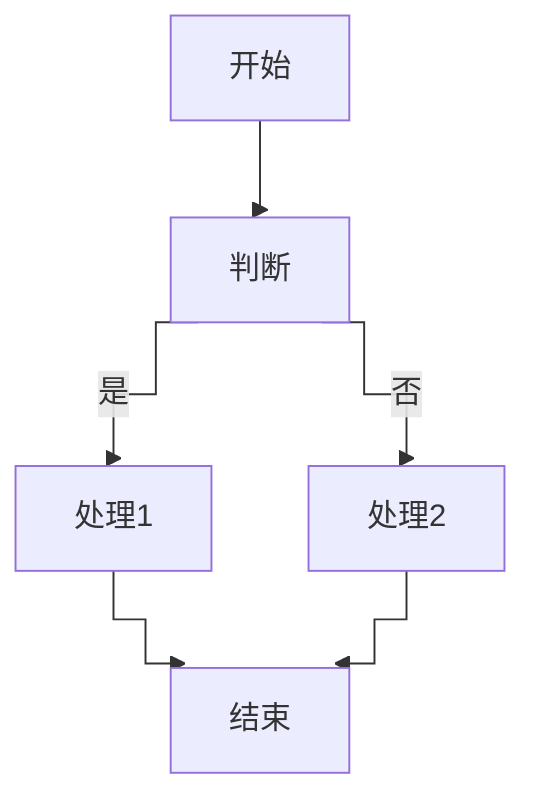
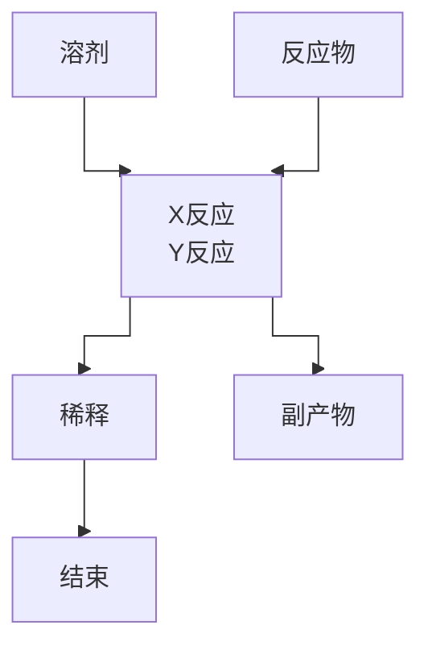

> 上篇文章,介绍了在Gmeek博客中添加Mermaid图表的支持,方便写博文时直接渲染流程图,而不需要自己绘制后截图上传.但是用多了,问题也很多,最终使用Graphviz DOT绘图以应对复杂的流程图绘制问题

## Graphviz DOT代码速览
```Graphviz DOT
digraph G {

  // ===== graph 级：整张图的布局规矩 =====
  graph [
    rankdir=TB,
    splines=ortho,
    nodesep=0.8,
    ranksep=0.65,
    pad=0.3,
    ordering=out,
    bgcolor="white",
    fontname="Microsoft YaHei"
  ]

  // ===== 默认样式：后续所有节点 / 边继承 =====
  node [shape=box, style="rounded,filled", fillcolor="#F5F0FF",
        color="#9B7FD4", penwidth=1.2, fontname="Microsoft YaHei",
        fontsize=14, fontcolor="#333333", margin="0.25,0.18"]
  edge [color="#333333", penwidth=1.2, arrowsize=0.7]

// ===== 节点定义 =====
A [label="流程A"]
B [label="流程B"]
C [label="流程C"]
D [label="流程D"]
E [label="流程E"]
F [label="流程F"]
G [label="流程G"]
H [label="流程H"]
I [label="流程I"]

// ===== 主链边 =====
A -> B [weight=10]
B -> C [weight=10]
C -> D [weight=10]
D -> E [weight=10]
E -> F [weight=10]

// ===== 侧链连接边 =====
B->G  [weight=1]
D->H  [weight=1]
I->E  [weight=1]

// ===== 匿名子图块：rank 约束 =====
{ rank=same; B; G }
{ rank=same; D; H }
{ rank=same; I; E }
}
```
从代码中可以看出,Graphviz DOT分成这么几块:
- 骨架模块,定义整张图的布局和样式
- 节点定义模块,定义各个节点的名称
- 主链边模块,定义"主链保直"涉及到的节点和连接顺序
- 侧链边模块,定义侧链涉及到的节点和连接顺序
- rank约束模块,定义哪些节点处于同一层
## 使用Excel生成Graphviz DOT代码
Graphviz DOT,如果每次作流程图都手敲完整代码/增删修改节点,会很麻烦.上面我们观察到Graphviz DOT代码非常模块化,骨架模块可以不用动,其他模块代码如果可以自动生成,那就很方便了.为此我们需要解决下面几个问题:
- 知道了主链节点和侧链节点数量,如何生成节点定义模块的代码
- 知道了主链节点的数量,如何生成主链边模块的代码
- 知道了侧链节点的连接方式,如何生成侧链连接边模块的代码
- 默认侧链连接边的2个节点处于同一层,如何生成rank约束模块的代码

为此我这边新建了一个`.xlsm`带宏的Excel文档(踩坑实录解释为什么需要带宏)

|  |A  |B  |C  |D  |E  |F  |G  |H  |
| --- | --- | --- | --- | --- | --- | --- | --- | --- |
|1  |主链数量  |6  |  |  |  |  |  |  |
|2  |侧链数量  |3  |  |  |  |  |  |  |
|3  |  |  |节点定义  |侧链  |顺序  |  |  |  |
|4  |主链 **<mark>*函数1生成*</mark>**   |A  |流程A  |B  |G  |  |骨架模块代码  |完整Graphviz DOT代码   |
|5  |主链  |B  |流程B  |D  |H  |  |<mark>*固定文本*</mark>  |***<mark>函数6生成</mark>***  |
|6  |主链  |C  |流程C  |I  |E  |  |节点模块代码  |  |
|7  |主链  |D  |流程D  |  |  |  |***<mark>函数2生成</mark>***  |  |
|8  |主链  |E  |流程E  |  |  |  |主链边模块代码  |  |
|9  |主链  |F  |流程F  |  |  |  |***<mark>函数3生成</mark></u>***  |  |
|10  |侧链  |G  |流程G  |  |  |  |侧链连接边模块代码  |  |
|11  |侧链  |H  |流程H  |  |  |  |***<mark>函数4生成</mark>***  |  |
|12  |侧链  |I  |流程I  |  |  |  |rank约束模块代码  |  |
|  |  |  |  |  |  |  |***<mark>函数5生成</mark>***  |  |

骨架模块代码固定文本
```code
digraph G {

  // ===== graph 级：整张图的布局规矩 =====
  graph [
    rankdir=TB,
    splines=ortho,
    nodesep=0.8,
    ranksep=0.65,
    pad=0.3,
    ordering=out,
    bgcolor="white",
    fontname="Microsoft YaHei"
  ]

  // ===== 默认样式：后续所有节点 / 边继承 =====
  node [shape=box, style="rounded,filled", fillcolor="#F5F0FF",
        color="#9B7FD4", penwidth=1.2, fontname="Microsoft YaHei",
        fontsize=14, fontcolor="#333333", margin="0.25,0.18"]
  edge [color="#333333", penwidth=1.2, arrowsize=0.7]
  ```
函数1:根据主链和侧链节点数量,按英文字母顺序,生成A4:B12的节点属性和字母
```excel
=LET(m,B1,n,B2,total,m+n,idx,SEQUENCE(total,,0),type,IF(idx<m,"主链","侧链"),letter,CHAR(65+idx),HSTACK(type,letter))
```
函数2:填写好C4:C12的节点定义后,生成节点定义模块代码
```excel
=TEXTJOIN(CHAR(10),,LET(b,B4:B50,c,C4:C50,mask,b<>"",fb,FILTER(b,mask),fc,FILTER(c,mask),fb&" [label="""&fc&"""]"))
```
函数3:筛选A4:A50区域,A列为"主链"的行,生成主链边模块代码
```excel
=TEXTJOIN(CHAR(10),,LET(data,FILTER(B4:B50,A4:A50="主链"),n,ROWS(data),i,SEQUENCE(n-1),INDEX(data,i)&" -> "&INDEX(data,i+1)&" [weight=10]"))=TEXTJOIN(CHAR(10),,LET(data,FILTER(B4:B50,A4:A50="主链"),n,ROWS(data),i,SEQUENCE(n-1),INDEX(data,i)&" -> "&INDEX(data,i+1)&" [weight=10]"))
```
函数4:D4:E50填写好侧链顺序,生成侧链连接边模块代码
```excel
=IF(OR(B2<=0,SUM((D4:D50<>"")*(E4:E50<>""))=0),"",TEXTJOIN(CHAR(10),,LET(d,D4:D50,e,E4:E50,mask,(d<>"")*(e<>""),fd,FILTER(d,mask),fe,FILTER(e,mask),fd&"->"&fe&"  [weight=1]")))
```
函数5:默认侧链节点处于同一层,生成rank约束模块代码
```excel
=IF(OR(B2<=0,SUM((D4:D50<>"")*(E4:E50<>""))=0),"",TEXTJOIN(CHAR(10),,LET(d,D4:D50,e,E4:E50,mask,(d<>"")*(e<>""),fd,FILTER(d,mask),fe,FILTER(e,mask),"{ rank=same; "&fd&"; "&fe&" }")))
```
函数6:将上述模块代码拼接
```excel
=G5&CHAR(10)&CHAR(10)&"// ===== 节点定义 ====="&CHAR(10)&G7&CHAR(10)&CHAR(10)&"// ===== 主链边 ====="&CHAR(10)&G9&CHAR(10)&CHAR(10)&"// ===== 侧链连接边 ====="&CHAR(10)&G11&CHAR(10)&CHAR(10)&"// ===== 匿名子图块：rank 约束 ====="&CHAR(10)&G13&CHAR(10)&"}"
```
最终效果如图所示:
完整Graphviz DOT代码区的代码符合规范,可以完全复制用于Graphviz DOT在线网站的生成


## 踩坑实录
### 1/ Mermaid缺点:
- [ ] Mermaid流程图,各个节点之间的连线默认是弯曲的
- 解决方案:声明`curve`样式,可选值:`linear`(纯直线),`step/step befroe/step after`直角折线

代码:
```code
---
config:
  flowchart:
    curve: step
---
flowchart TD
    A[开始] --> B[判断]
    B -->|是| C[处理1]
    B -->|否| D[处理2]
    C --> E[结束]
    D --> E
```
效果:

- [ ] 使用 `curve: step`样式,有些时候两个节点之间会出现很多台阶.原因是step 是“每根边都走曼哈顿折线”,Mermaid 自动布局（DAG 分层）会把节点摆在不同 rank,于是: 1/ 同层节点错位 → 线先横再竖再横 2/ 分支汇合 → 自动绕路 3/ 节点没对齐 → 一根线拐两三次
- 解决方案:舍弃Mermaid,换用Visio/PPT/Excel使用肘形连接符,Excel中以2*2合并单元格为1个节点,可以做到统一尺寸的节点方框+alt移动连接符自动吸附节点的线段中点,也是比较规整好看的
- [ ] 当Mermaid图表存在侧链时,侧链E/F的存在会影响主链A→D的准直.原因是 **「主链绝对垂直」在 Mermaid 里根本做不到** .`curve: stepBefore`只负责把线掰成直角,管不了节点站在哪.布局引擎是按「边的依赖」分层(rank),不是按你写的行序.甚至有时候`stepBefore`会把原本一条斜线拆成「竖—横—竖」,反而把这种偏移显形成了更多台阶;实测里 `step`类曲线的绕路程度比默认曲线还高.更硬的限制: Mermaid 是声明式语法，**没有 ` rank=same `，也没有给节点指定 (x, y) 的能力**，这个需求在官方 issue \#3723 挂了四年仍未解决;` ~~~ ` 不可见边和 subgraph 的 ` direction ` 在跨边界有连线时都会被忽略或产生不可预测的偏移 .换 ` layout: elk ` / ` flowchart-elk ` 也只是换一套自动布局,同样不保证严格同列 .
 - 案例:

- 解决方案:1/ 同上,Visio/PPT/Excel绘制, 2/ Graphviz 用 ` rank=same ` 锁层

### 2/ 侧链数量为0时,侧链连接边模块代码和rank约束模块代码报错,完整代码无法生成
原函数4和函数5如下,当侧链为0或侧链顺序区没有填写时,侧链连接边模块代码和rank约束模块代码会报错,更正后的代码从侧链数量和侧链顺序区空值入手,添加IF函数判断`=IF(OR(B2<=0,SUM((D4:D50<>"")*(E4:E50<>""))=0),"",...`,用于覆盖仅含主链的流程图情形
```excel
=TEXTJOIN(CHAR(10),,
  LET(
    d, D4:D50,
    e, E4:E50,
    mask, (d<>"")*(e<>""),
    fd, FILTER(d, mask),
    fe, FILTER(e, mask),
    fd & "->" & fe & "  [weight=1]"
  )
)
```
```excel
=TEXTJOIN(CHAR(10),,
  LET(
    d, D4:D50,
    e, E4:E50,
    mask, (d<>"")*(e<>""),
    fd, FILTER(d, mask),
    fe, FILTER(e, mask),
    "{ rank=same; " & fd & "; " & fe & " }"
  )
)
```
### 3/ 右键完整Graphviz DOT代码区的单元格,复制出来的代码为什么多了很多双引号
- 现象:单元格里显示的是 ` bgcolor="white" `,粘到记事本 / VS Code / .dot 就成了 ` bgcolor=""white""`. 整段代码的首尾还各多了一个` " `
- 原因: 这是 **Excel 本身的行为**,而且**没有设置能关掉** --既不是公式写错，也不是显示或"自动换行"的问题.根因是 **复制「单元格」≠ 复制「单元格里的文本」**
  Excel 往剪贴板写的纯文本是按 CSV / 制表符分隔文本的规则序列化的：
   - 单元格内容含 `CHAR(10)` 换行 → 整块被当成一个字段，外面包一层 `"`
   - 字段内部的 `"` → 按 CSV 规则翻倍成 `""`
- 解决方案:细心的应该发现上面最终效果图里有一个`复制完整graphviz代码`的按钮,这也是为什么我要选择带宏的`.xlsm`格式,添加一个按钮并复制粘贴下面vba宏代码即可,以后只需点击按钮即可把干净的Graphviz DOT代码复制到剪切板
```vba
Sub 复制完整graphviz代码()

    Dim s As String
    Dim cb As Object
    s = ActiveSheet.Range("H5").Value2
    Set cb = CreateObject("new:{1C3B4210-F441-11CE-B9EA-00AA006B1A69}")
    cb.SetText s
    cb.PutInClipboard
    ' MsgBox "已复制干净代码", vbInformation   '需要提示就取消注释

End Sub
```
### 4/ 如果需要手动控制节点E/F分别放置节点B的左右侧时,代码怎么改
在 Graphviz 里用 **端口（port / compass point）** 控制箭头从 B 的哪一侧进入。[*个人常用1号写法,修改rank约束模块代码*]
- 1. 直接在边里写 :w :e
w = west（左边）
e = east（右边）
还有 n s nw ne sw se
```dot
A -> B:w;   // 箭头从 B 的【左边】进入
A -> B:e;   // 箭头从 B 的【右边】进入
A -> B:n;   // 从上方进入
A -> B:s;   // 从下方进入
```
- 2. 同时控制起点和终点
```dot
A:e -> B:w;   // A右边出，B左边进（典型左→右流程图）
A:w -> B:e;   // A左边出，B右边进
```
- 3. 用边属性 headport / tailport
```dot
A -> B [headport=w];   // 箭头端（head）连到 B 左边
A -> B [headport=e];   // 箭头端连到 B 右边
A -> B [tailport=e, headport=w];
```
